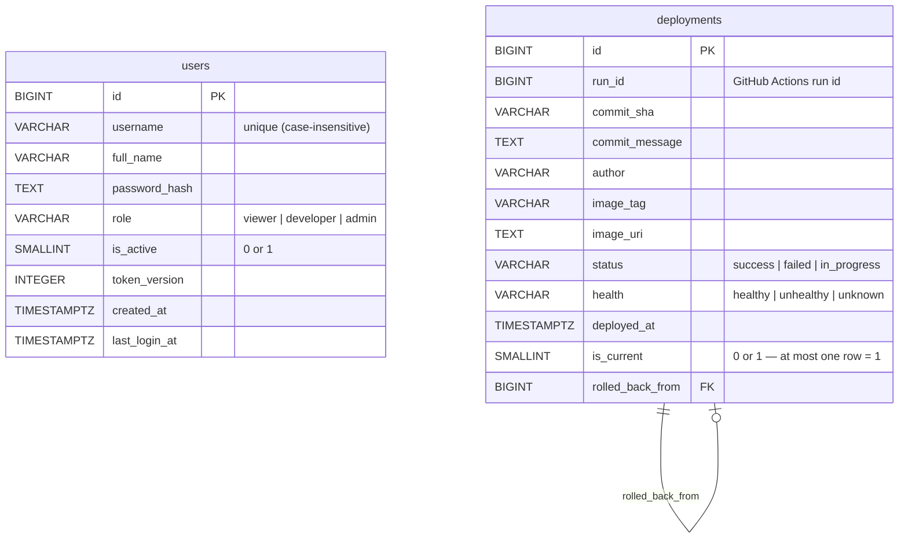

# Database Guide

## Which Engine to Use?

| Scenario | Engine | How |
|---|---|---|
| Local development / demo | **SQLite** | Default — no config needed |
| Docker Compose (local prod-like) | **PostgreSQL 16** | `docker compose up` |
| AWS production | **Amazon RDS for PostgreSQL** | Set `DATABASE_URL` |

---

## ER Diagram



---

## Table Dictionary

### `users`

| Column | Type | Description |
|---|---|---|
| `id` | BIGSERIAL / INTEGER | Primary key |
| `username` | VARCHAR(32) | Login handle — unique case-insensitively |
| `full_name` | VARCHAR(120) | Display name |
| `password_hash` | TEXT | Werkzeug/bcrypt hash — never stored plain |
| `role` | VARCHAR(10) | One of `viewer`, `developer`, `admin` |
| `is_active` | SMALLINT | `1` = can login; `0` = locked out |
| `token_version` | INTEGER | Bumped on password/role change to revoke all sessions |
| `created_at` | TIMESTAMPTZ | UTC creation timestamp |
| `last_login_at` | TIMESTAMPTZ | UTC timestamp of last successful login |

### `deployments`

| Column | Type | Description |
|---|---|---|
| `id` | BIGSERIAL / INTEGER | Primary key |
| `run_id` | BIGINT | GitHub Actions run ID (>32-bit, validated) |
| `commit_sha` | VARCHAR(64) | Git commit hash |
| `commit_message` | TEXT | Commit message |
| `author` | VARCHAR(120) | Committer / GitHub Actions |
| `image_tag` | VARCHAR(200) | Docker image tag deployed |
| `image_uri` | TEXT | Full ECR URI |
| `status` | VARCHAR(12) | `success`, `failed`, or `in_progress` |
| `health` | VARCHAR(10) | `healthy`, `unhealthy`, or `unknown` |
| `deployed_at` | TIMESTAMPTZ | When the deployment completed |
| `is_current` | SMALLINT | `1` for the live release (at most one row) |
| `rolled_back_from` | BIGINT FK | If set, points to the deployment this replaced |

---

## Database-Enforced Rules

- `role` must be one of `viewer`, `developer`, `admin` (CHECK constraint)
- `status` must be one of `success`, `failed`, `in_progress` (CHECK constraint)
- `health` must be one of `healthy`, `unhealthy`, `unknown` (CHECK constraint)
- `is_active` and `is_current` must be `0` or `1` (CHECK constraint)
- `lower(username)` is unique — "Admin" and "admin" collide
- At most **one** deployment may have `is_current = 1` (partial unique index)
- `rolled_back_from` references `deployments(id)` with `ON DELETE SET NULL`
- Index on `deployments(deployed_at DESC)` for fast history queries

---

## How to Connect with psql

```bash
# Via Docker Compose
docker compose exec db psql -U deployhub -d deployhub

# List tables
\dt

# Quit
\q
```

---

## How to Change Engines

**SQLite → PostgreSQL (Docker):**
```bash
# 1. Copy and fill .env
cp .env.example .env
# edit .env — set POSTGRES_PASSWORD, SECRET_KEY, etc.

# 2. Start
docker compose up --build -d

# 3. Verify
docker compose exec db psql -U deployhub -d deployhub -c "\dt"
```

**SQLite → Amazon RDS:**
```bash
# Set DATABASE_URL in your environment or .env
DATABASE_URL=postgresql://deployhub:<password>@<rds-endpoint>:5432/deployhub
```

**Moving from SQLite to PostgreSQL:**
1. Export data from SQLite: `sqlite3 data/cicd.db .dump > dump.sql`
2. The schema is automatically created by the app on first start
3. Re-seed users via `ADMIN_USERNAME` / `ADMIN_PASSWORD` env vars, or use the API
4. Pipeline run history lives in GitHub — not the database — so nothing is lost

---

## Backup & Restore

See [`backup.sh`](./backup.sh) and [`restore.sh`](./restore.sh).

```bash
# Backup (creates timestamped .sql.gz)
./database/backup.sh

# Restore
./database/restore.sh ./database/backups/deployhub_2026-10-10_00-00-00.sql.gz
```
